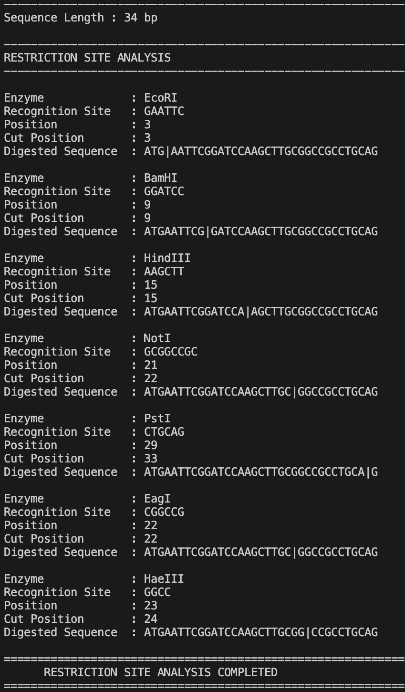

# DNA Restriction Site Finder

A Python command-line tool that scans DNA for exact recognition sequences from a built-in set of 30 restriction enzymes. It reports each match and marks its strand cut boundary with `|`.

## Quick start

Requires Python 3 and Git for the clone command. No third-party Python packages are required.

    git clone https://github.com/harshitmishra0310/restriction_site.git
    cd restriction_site
    python3 restriction_site.py

## Example

Input: `ATGAATTCGGATCCAAGCTTGCGGCCGCCTGCAG`

The sequence is 34 bp long. Selected results are shown below; the complete run also reports NotI, PstI, EagI and HaeIII.

| Enzyme | Recognition-site start | Cut boundary |
|---|---|---|
| EcoRI | 3 | 3 |
| BamHI | 9 | 9 |
| HindIII | 15 | 15 |

For EcoRI, the displayed sequence begins `ATG|AATTC...`.

## Reading the coordinates

`Position` is the 1-based index of the first base of the recognition sequence. `Cut Position` is the number of bases before the cut: a value of 3 means the boundary between bases 3 and 4. Internally it equals the zero-based match start plus the enzyme's stored cut offset.

## Scope and limitations

- The search advances one base after each match, allowing repeated and overlapping matches.
- Each output sequence marks one cut independently. The program does not calculate digest fragments, fragment lengths or a combined restriction map.
- The current model uses exact matches on the supplied linear sequence and one stored strand offset. It does not model circular junctions, double-stranded overhangs, methylation or reaction conditions.
- FASTA files and ambiguous nucleotide symbols are not supported.
- Enzyme recognition sequences and offsets are stored in the script. Reference validation and data provenance should be added before extending the enzyme set.
## Program preview

## Author

Harshit Mishra — B.Tech Bioinformatics student at Shoolini University.

## License

MIT License. See the license file in this repository.
